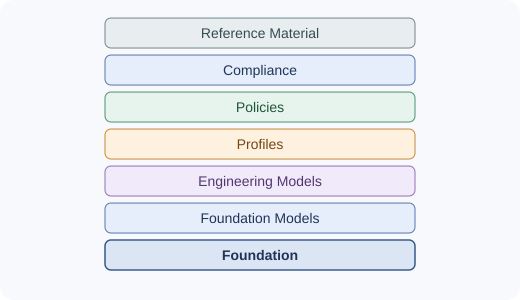

# BAES Updates

**Public updates, research notes, and collaboration information for the Babak AI Engineering Standard (BAES).**

BAES-Updates is the public-facing activity and update space associated with BAES. It records selected developments, research activities, and opportunities for external discussion without replacing the standard itself.

## Start here

Choose the path that best matches what you need:

| If you want to… | Start here |
|---|---|
| Understand the BAES standard | [BAES-Public](https://github.com/babak-rasti-meymandi/BAES-Public) |
| Discuss a practical engineering problem involving human authority, AI delegation, or evidence | [**Authority & Evidence Consulting**](collaboration/authority-and-evidence-consulting.md) |
| Explore research funding or independent research collaboration | [Research and collaboration opportunities](collaboration/current-opportunities.md) |
| Read the proposed research design and budget | [Independent Evaluation — Research Brief](collaboration/evaluation-brief.md) |
| Review the separate evaluation project | [Human-AI-Authorization-Evaluation](https://github.com/babak-rasti-meymandi/Human-AI-Authorization-Evaluation) |
| Follow dated activity | [News and updates](news/README.md) |

**Commercial consulting and research funding are separate paths.** Consulting fees are quoted after the commercial scope is defined. The separate research proposal has its own research question, planned deliverables, schedule, and indicative budget.

## Purpose

This repository is intended to:

- publish concise, dated updates about public BAES-related work;
- maintain a clear record of research activities and their status;
- describe independent evaluation work at an appropriate public level;
- make commercial consulting, research collaboration, and funding routes easier to distinguish and find;
- distinguish completed work, ongoing work, submitted proposals, and outcomes that are not yet known.

## Relationship to the BAES repositories

| Repository | Role |
|---|---|
| [BAES-Public](https://github.com/babak-rasti-meymandi/BAES-Public) | The stable public reference for the BAES standard. |
| **BAES-Updates** | Public updates, activity records, research notes, and collaboration information related to BAES. |
| [Human-AI-Authorization-Evaluation](https://github.com/babak-rasti-meymandi/Human-AI-Authorization-Evaluation) | A separate project for empirical evaluation of human authorization and semantic deviation in AI-assisted engineering. |

BAES-Updates is not a replacement for BAES-Public and does not redefine the standard. Changes to the standard itself belong in the appropriate standard repository and should follow its own change-control expectations.

*Conceptual overview of the BAES layers; this diagram describes structure and is not evidence of independent validation.*

## Repository structure

- **[collaboration/](collaboration/README.md)** — commercial consulting, research collaboration, and funding opportunities.
- **[Authority & Evidence Consulting](collaboration/authority-and-evidence-consulting.md)** — proposed written-first consulting on human authority, delegated AI action, evidence, and traceability.
- **[Current research and collaboration opportunities](collaboration/current-opportunities.md)** — the independent evaluation proposal, including its scope, expected deliverables, duration, and indicative funding request.
- **[Evaluation brief](collaboration/evaluation-brief.md)** — the bounded research question, method, milestones, deliverables, budget assumptions, and safeguards.
- **[research/](research/README.md)** — research questions, study notes, evaluation plans, and public research outputs.
- **[news/](news/README.md)** — dated public announcements and activity updates.
- **[Image assets and usage guidance](assets/images/README.md)** — conceptual diagrams and the thematic SVG icon library.

Each section may grow as there is substantive material to publish. The structure is intentionally lightweight; files should be added when they serve a clear purpose.

## Publication principles

1. **Accuracy of status:** distinguish proposals submitted from proposals accepted, and planned work from completed results.
2. **Evidence before claims:** report methods, observations, limitations, and outcomes without overstating what they demonstrate.
3. **Public-safe disclosure:** do not publish confidential material, private correspondence, credentials, or restricted project content.
4. **Separation of concerns:** keep standard definitions in BAES-Public, project-specific evaluation material in its dedicated repository, and commercial consulting separate from research proposals.
5. **Traceability:** where useful, give updates dates, links to public artifacts, and a clear indication of status.
6. **No implied endorsement:** references to external organizations, standards, or projects do not imply their endorsement of BAES.

## Current status

This repository is a public record for selected BAES-related updates, research activity, and proposed engagement routes. The consulting page describes a proposed service, not a completed independent validation. The existence of an activity record or proposal does not imply external endorsement, funding, acceptance, or validation.

## Contributing and contact

For research discussion, potential collaboration, or commercial consulting, start with [Collaboration](collaboration/README.md). Any proposed change to the BAES standard should be directed to [BAES-Public](https://github.com/babak-rasti-meymandi/BAES-Public), rather than treated as a change to this updates repository.

---

*BAES — Babak AI Engineering Standard*
