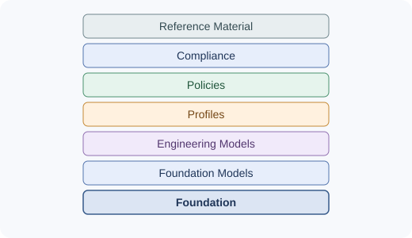

# BAES Updates

**Public information on BAES-related collaboration, sponsorship, consulting, and selected research activity.**

BAES-Updates is the public-facing space for selected collaboration opportunities, research activity, and development-related information associated with the Babak AI Engineering Standard (BAES).

It complements the standard's public reference. It does not replace BAES-Public or redefine the standard.

## Start here

| If you want to… | Start here |
|---|---|
| Understand the BAES standard and its established Foundation | [BAES-Public](https://github.com/babak-rasti-meymandi/BAES-Public) |
| Review the Foundation's current status and maturity boundaries | [BAES Foundation Status & Maturity](https://github.com/babak-rasti-meymandi/BAES-Public/blob/main/06_BAES_Foundation_Status_and_Maturity.md) |
| Discuss a practical engineering problem involving human authority, AI delegation, or evidence | [Authority & Evidence Consulting](collaboration/authority-and-evidence-consulting.md) |
| Explore founding sponsorship and research collaboration | [Current Opportunities](collaboration/current-opportunities.md) |
| Review the independent evaluation research design | [Evaluation Brief](collaboration/evaluation-brief.md) |
| Review the separate empirical evaluation project | [Human-AI-Authorization-Evaluation](https://github.com/babak-rasti-meymandi/Human-AI-Authorization-Evaluation) |

**Commercial consulting and founding sponsorship are separate engagement paths.** Consulting fees are defined after the scope is agreed. Sponsorship is a separate contribution governed by written terms; it does not automatically purchase consulting services or transfer ownership of BAES.

## Purpose

This repository provides public information about:

- founding sponsorship and research collaboration opportunities;
- the proposed Authority & Evidence consulting service;
- independent research scope, status, and supporting documents;
- selected development-related information intended for external discussion.

It is intended to make engagement routes clear while keeping the standard's definitions and architecture in their appropriate reference repository.

## Relationship to the BAES repositories

| Repository | Role |
|---|---|
| [BAES-Public](https://github.com/babak-rasti-meymandi/BAES-Public) | The stable public reference for the BAES standard, its Foundation, architecture, and published status. |
| **BAES-Updates** | Public information about collaboration, sponsorship, consulting, and selected research activity. |
| [Human-AI-Authorization-Evaluation](https://github.com/babak-rasti-meymandi/Human-AI-Authorization-Evaluation) | A separate project for empirical evaluation of human authorization and semantic deviation in AI-assisted engineering. |

BAES-Updates does not replace BAES-Public. Changes to the standard itself belong in the appropriate standard repository and follow its own change-control expectations.

*Conceptual overview of the BAES layers. This diagram is explanatory and is not evidence of independent validation.*

## Repository structure

- **[collaboration/](collaboration/README.md)** — commercial consulting, founding sponsorship, and research collaboration.
- **[Authority & Evidence Consulting](collaboration/authority-and-evidence-consulting.md)** — proposed written-first consulting on human authority, delegated AI action, evidence, and traceability.
- **[Current Opportunities](collaboration/current-opportunities.md)** — founding sponsorship and research collaboration information.
- **[Evaluation Brief](collaboration/evaluation-brief.md)** — the independent evaluation's research question, method, phases, deliverables, budget, and limitations.
- **[research/](research/README.md)** — existing research notes and materials retained pending their planned integration into a separate repository.
- **[Image assets and usage guidance](assets/images/README.md)** — conceptual diagrams and the thematic SVG icon library.

## Publication principles

1. **Accurate status:** distinguish proposed, active, deferred, completed, and independently verified work.
2. **Evidence before claims:** report methods, observations, limitations, and outcomes without overstating what they demonstrate.
3. **Research independence:** sponsorship or collaboration must not predetermine research findings or control BAES standardization decisions.
4. **Intellectual-property clarity:** ownership, licensing, permitted use, and any commercial rights must be defined separately in writing.
5. **Public-safe disclosure:** do not publish confidential material, private correspondence, credentials, or restricted project content.
6. **No implied endorsement:** references to external organizations, standards, or projects do not imply their endorsement of BAES.

## Current status

BAES-Updates describes proposed engagement routes and selected research activity. The existence of a proposal or consulting page does not imply secured funding, an existing partnership, completed independent validation, certification, or endorsement.

The BAES Foundation and its published status should be assessed through the relevant documents in [BAES-Public](https://github.com/babak-rasti-meymandi/BAES-Public).

## Contact and next steps

For commercial consulting, founding sponsorship, or research collaboration, start with the [Collaboration page](collaboration/README.md).

Initial inquiries can be made in writing through the public contact route listed on the maintainer's [GitHub profile](https://github.com/babak-rasti-meymandi).

Do not include credentials, confidential code, or restricted organizational information in a public message. Any engagement must have a defined scope and written terms.

---

*BAES — Babak AI Engineering Standard*
