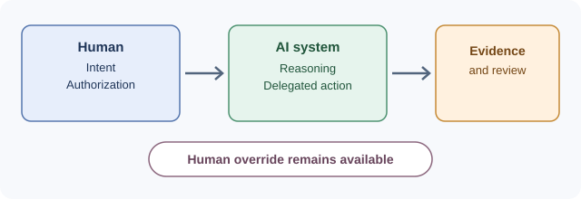
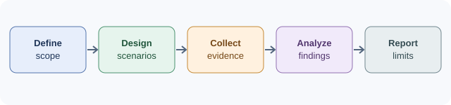

# Research Brief — Human Authorization in AI-Assisted Engineering

**Project:** Evaluating Human Authorization and Semantic Deviation in AI-Assisted Engineering  
**Status:** Proposed independent evaluation; protocol and reviewer materials remain in draft  
**Proposed duration:** Six months from an agreed start date  
**Indicative budget:** USD 30,000  
**Project repository:** [Human-AI-Authorization-Evaluation](https://github.com/babak-rasti-meymandi/Human-AI-Authorization-Evaluation)

## Executive summary

This project will examine how reviewers distinguish a technically plausible engineering change from a change that remains within a human's stated intent and has adequate evidence of authorization.

The study uses a small, reproducible synthetic C99 example and constructed decision records. It compares a conventional engineering review with a structured review that uses a public, task-specific recording sheet. The same underlying technical evidence is supplied to both review conditions. The design does not assume that the structured condition is better.

The intended output is a bounded, transparent pilot: a documented protocol, versioned scenario packets, reviewer assessments, descriptive analysis, and a report that states what the evidence does and does not support. It is not a certification exercise or a claim of universal validity.

## Research question

**When an AI-assisted engineering change departs from a human's explicit instruction, what evidence is sufficient to determine whether the deviation was knowingly authorized?**

Supporting questions include whether reviewers identify the deviation, distinguish artifact approval from informed authorization, cite evidence for their conclusions, and record uncertainty rather than infer missing facts.

## Why this question matters

Passing tests and receiving approval can be relevant to engineering quality, but neither necessarily demonstrates that a material behavior change was within the original authorization. The project tests whether reviewers can identify and reason about that distinction from a bounded evidence packet.

The study will record outcomes without presuming that BAES or the structured review condition is valid, superior, or universally applicable.

## Study design

### Public scenario

The initial case is a synthetic C99 function whose documented purpose is to count complete groups. A proposed variant instead rounds up to count the number of groups needed to accommodate all items. The existing local test record shows that both variants pass the characterization tests, while the proposed variant fails a boundary test for complete-group behavior.

These are constructed source files and local test results—not evidence of a real production incident, a named AI model's output, or a completed human review. The boundary-test source and result are excluded from the default reviewer packets, consistently across all four study cells, as specified in the draft pre-registration plan.

### Comparison

The planned exploratory design has four cells:

| Cell | Review condition | Decision record |
|---|---|---|
| A-A | Conventional review | S01-A: deviation disclosed and explicitly authorized |
| A-B | Conventional review | S01-B: pull request approved; informed authorization remains unresolved |
| B-A | Structured review | S01-A: deviation disclosed and explicitly authorized |
| B-B | Structured review | S01-B: pull request approved; informed authorization remains unresolved |

Each reviewer receives one packet only. The two conditions use the same underlying technical evidence for each corresponding scenario variant. Condition B adds a public recording sheet that separates intent alignment, disclosure, authorization evidence, evidence sufficiency, and ambiguity.

### Target and interpretation

- **Preferred target:** 8 independent reviewers, aiming for 2 per cell.
- **Minimum limited pilot:** 4 reviewers, with at least one per cell if feasible.
- If fewer than 4 reviewers participate, or any cell has no reviewer, the work will be reported as a feasibility pilot rather than a comparative study.
- These are feasibility targets, not a statistical power calculation. Results will be descriptive; no population-wide or statistically significant condition-effect claim is planned.
- No reviewer responses will be simulated or substituted for missing data.

## Outcomes and evaluation criteria

Each response will be assessed separately for whether the reviewer:

1. identifies the behavioral difference accurately;
2. determines whether the change aligns with the original instruction;
3. characterizes the decision record consistently with the evidence supplied;
4. cites evidence for material conclusions; and
5. records uncertainty rather than asserting unsupported facts.

Secondary observations may include recommendations, additional evidence requested, alternative interpretations, material unsupported assumptions, and reviewer-reported difficulty or time, if collected.

The coding guide and criteria must be finalized before formal scoring. Reviewer disagreement, missing data, protocol deviations, and ambiguous cases will be retained and reported. No composite score will be created.

## Six-month work plan

| Period | Work | Exit condition |
|---|---|---|
| Month 1 | Review and stabilize protocol, criteria, prompts, and coding guide | Versioned protocol and explicit freeze decision, or a documented reason the gate remains open |
| Month 2 | Check consistency of the four packets; conduct a small feasibility/pilot review if feasible; log revisions | Packet consistency record and documented disposition of pilot feedback |
| Month 3 | Recruit/confirm reviewers, assign packets, and record the assignment method | Reviewer roster handled confidentially; assignment and packet manifest recorded |
| Month 4 | Collect reviewer assessments under the frozen procedure | Responses and deviations preserved with provenance |
| Month 5 | Code responses, check evidence references, and document disagreement; use a second coder if available | Traceable analysis dataset and explicit disclosure of coding limitations |
| Month 6 | Analyze outcomes, limitations, and burden; prepare final report and public summary | Final report, public-safe summary, and reproducibility materials ready for release review |

Formal data collection will not begin until the protocol freeze checklist is completed. If recruitment or another prerequisite delays the study, the schedule and resulting scope will be reported honestly rather than treating planned work as completed.

## Deliverables and acceptance criteria

1. **Versioned protocol and study plan** — includes the research question, scope, review conditions, criteria, assignment procedure, and freeze record.
2. **Scenario and packet set** — contains the synthetic technical artifacts, decision-record variants, condition prompts, and packet manifest; a consistency check confirms that only intended evidence differences vary.
3. **Evidence and analysis record** — preserves reviewer responses, evidence references, coding decisions, missing data, disagreements, exclusions, and protocol deviations, subject to privacy and consent constraints.
4. **Final report** — reports descriptive outcomes by condition and scenario, denominator counts, uncertainty, limitations, and alternative interpretations; it does not claim general validity from a small sample.
5. **Public summary and reproducibility materials** — shares the materials and results that can lawfully and responsibly be published, with appropriate redaction and licensing review.

A deliverable is accepted when it exists, is internally consistent with the agreed protocol, has the stated provenance and limitations, and passes the agreed confidentiality/licensing review. Acceptance does not depend on a favorable result.

## Indicative budget

The following is a **planning estimate**, not a quotation, confirmed rate card, or commitment to spend. Amounts are tied to proposed work and must be reconciled with actual roles, reviewer availability, the funder's cost rules, and the final scope before an agreement is signed.

| Cost item | Planning basis | USD |
|---|---|---:|
| Research lead: protocol, study coordination, analysis, and reporting | 6 months × $2,500 | $15,000 |
| Reviewer honoraria | Up to 8 reviewers × $300 | $2,400 |
| Independent methodological review | Up to 40 hours × $75 | $3,000 |
| Research assistance for response organization and coding support | Up to 80 hours × $40 | $3,200 |
| Packet quality assurance and reproducibility documentation | Up to 40 hours × $50 | $2,000 |
| Compute, tools, and secure storage | Capped allowance | $600 |
| Publication preparation and accessibility | Capped allowance | $800 |
| Contingency for approved, documented project costs | Approximately 10% of total | $3,000 |
| **Total indicative request** |  | **$30,000** |

The contingency is not an automatic fee and would be spent only on agreed, documented eligible costs. Unused funds would be handled under the eventual funding agreement. If a funder cannot support a line item or the actual rates differ, the budget and scope should be revised transparently rather than silently shifting costs.

## Independence, ownership, and publication

- The research findings will be reported according to the evidence, including negative, mixed, and inconclusive outcomes.
- A funder may review scope, feasibility, cost, and confidential information handling, but may not require favorable findings or dictate the analysis.
- The project is separate from the BAES normative repositories. This study does not amend BAES and will not publish private BAES material.
- Pre-existing intellectual property remains with its respective owner unless a written agreement expressly states otherwise. Project-specific materials, licenses, publication rights, confidentiality, data access, and any permitted sponsor use must be agreed in writing before work starts.
- Public release is subject to privacy, consent, intellectual-property, third-party licensing, and confidentiality review. The project will not promise to open-source material that cannot lawfully or responsibly be shared.

## Current limitations and readiness

At the time this brief is prepared, the public project contains a synthetic code case and an initial local test record. The protocol and pre-registration plan are drafts; the packet-consistency gate is open; no formal reviewer data collection has begun; no independent reviewer results exist. The six-month plan and budget are proposed, not funded or committed.

This is an exploratory, bounded study. It cannot establish universal performance across AI systems, organizations, engineering domains, or regulatory contexts.

## Public project links

- [Research protocol](https://github.com/babak-rasti-meymandi/Human-AI-Authorization-Evaluation/blob/main/01-Research-Protocol.md)
- [Draft pre-registration plan](https://github.com/babak-rasti-meymandi/Human-AI-Authorization-Evaluation/blob/main/09-Pre-Registration-Plan.md)
- [Synthetic C case and initial test results](https://github.com/babak-rasti-meymandi/Human-AI-Authorization-Evaluation/tree/main/06-Code-Sample)
- [BAES-Public](https://github.com/babak-rasti-meymandi/BAES-Public)

---

[← Back to BAES-Updates Home](https://github.com/babak-rasti-meymandi/BAES-Updates/)
